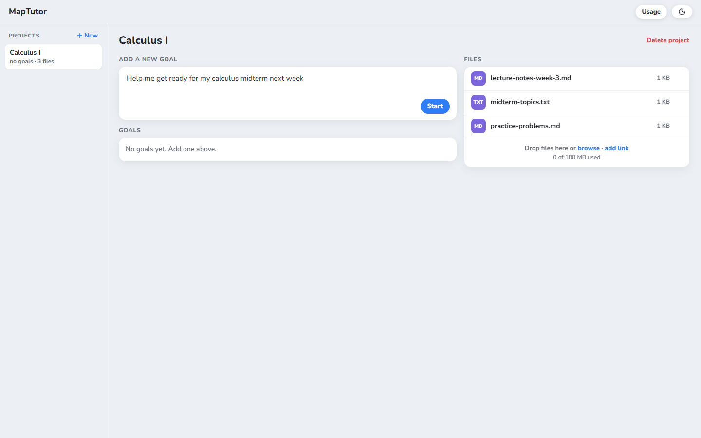
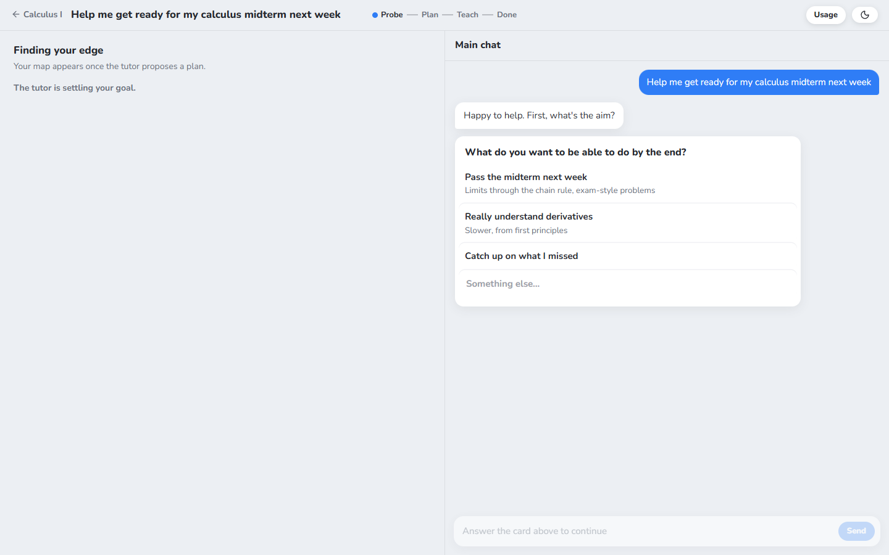
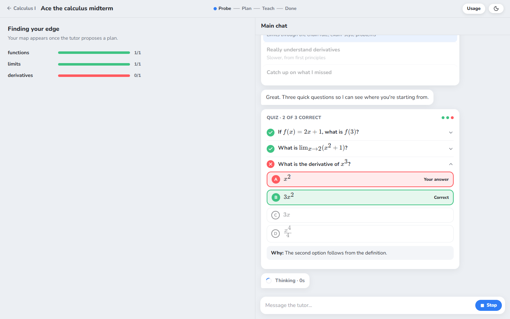
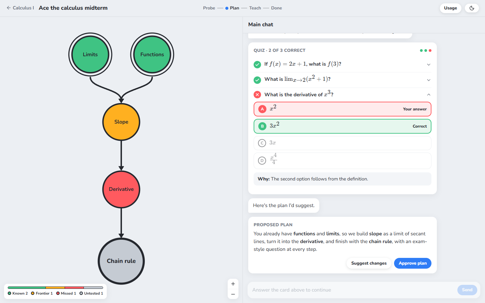
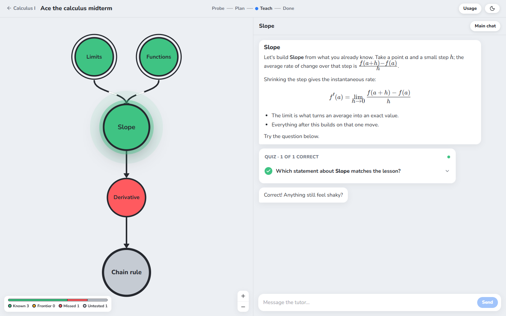
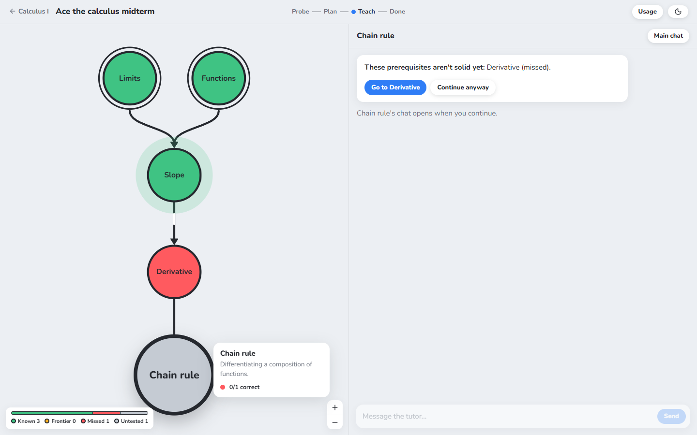
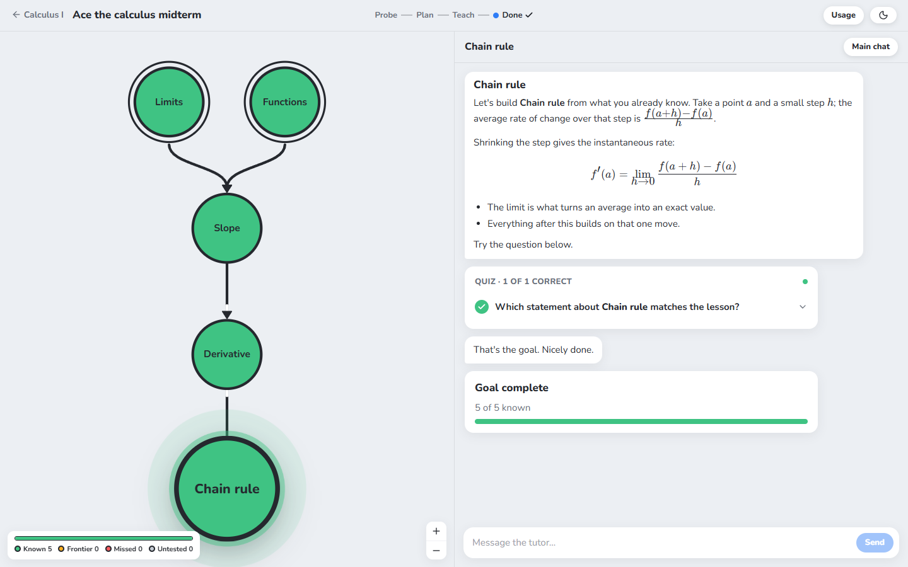

# MapTutor

MapTutor is a web app that runs a Claude tutor. You state a goal, and the tutor finds the edge
of what you know with a short quiz. It then maps the topics between you and the goal and teaches
them one at a time. Lessons work through problems, and the tutor asks you questions throughout, not
only in the quiz checks.

MapTutor runs on your own Claude subscription through the
[Claude Agent SDK](https://code.claude.com/docs/en/agent-sdk), for personal use only.

## Demo

1. Create a project, add context files, and describe your goal.

   

2. Answer the tutor's follow-up questions.

   

3. Take the edge-finding quiz. Results appear as soon as you submit.

   

4. Approve the tutor's plan, or suggest changes.

   

5. Learn each topic in its own thread. Each lesson ends with a quiz check.

   

6. Open any topic. If its prerequisites aren't solid, the tutor warns you first.

   

7. Pass the goal topic to complete the goal.

   

## Features

- Context files: PDFs, images, Markdown files, text notes, and web links.
- Topic states: Untested (gray), Missed (red), Frontier (amber), and Known (green). Only quiz
  results can mark a topic as known.
- **Stop** and **Retry** in the chat, and a **Usage** popover with token counts.
- Light and dark themes.

## Run MapTutor

You need [Node.js](https://nodejs.org/) 24 or later and the
[Claude Code](https://code.claude.com/docs) CLI.

1. Install the dependencies:

   ```bash
   npm install
   ```

1. Run `claude setup-token`, and set the token it prints as the `CLAUDE_CODE_OAUTH_TOKEN`
   environment variable. On Windows, run `setx CLAUDE_CODE_OAUTH_TOKEN "TOKEN"`, then open a new
   terminal.

1. In two terminals, start the server and the web app:

   ```bash
   npm run dev:server
   npm run dev:web
   ```

1. Go to `http://localhost:5173`.

To open PDFs larger than 5 MB, the tutor needs [Poppler](https://poppler.freedesktop.org/). On
Windows, run `scoop install poppler`.
